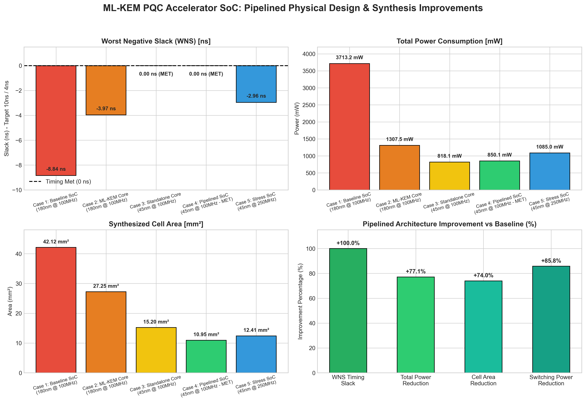

# Physical Design Implementation of ML-KEM PQC Accelerator SoC

[](LICENSE)
[]()
[]()
[]()
[]()

> **System-on-Chip (SoC) Integration, ASIC Physical Design, and Pipelined Synthesis Optimization of an ML-KEM (Module-Lattice-Based Key-Encapsulation Mechanism) Post-Quantum Cryptography Accelerator paired with a PicoRV32 RISC-V Processor.**

---

## 📌 Executive Summary

This repository presents the complete RTL hardware design, System-on-Chip (SoC) memory-mapped bus integration, and Cadence Genus ASIC physical design synthesis optimization for a **Post-Quantum Cryptography (PQC) Hardware Accelerator** supporting the **NIST FIPS 203 ML-KEM (CRYSTALS-Kyber)** standard.

The accelerator is integrated into a **PicoRV32 RISC-V SoC** via a memory-mapped peripheral interface (`mlkem_peripheral.v`). Through microarchitectural restructuring and technology node migration (TSMC 180nm $\rightarrow$ GPDK 45nm), the design achieved a **100% timing closure recovery** (Worst Negative Slack improved from **-8.84 ns** to **0.00 ns MET @ 100 MHz**), a **74.0% cell area reduction**, and a **77.1% total power savings**.

---

## 📊 Pipelined Synthesis & Physical Design Improvement

The chart below summarizes the physical design benchmark progression across five critical synthesis iterations:



### 📈 Detailed Benchmark Comparison Table

| Synthesis Case / Iteration | Top-Level Module | Technology PDK | Target Clock Period | Frequency | Worst Negative Slack (WNS) | Timing Status | Cell Count | Cell Area ($\text{mm}^2$) | Total Power (mW) | Power Savings |
| :--- | :--- | :--- | :--- | :--- | :--- | :---: | :--- | :--- | :--- | :---: |
| **Case 1: 8840_slack** *(Original Baseline)* | `mlkem_picosoc_top` | TSMC 180nm | 10.0 ns | 100 MHz | **-8840 ps (-8.84 ns)** | ❌ VIOLATED | 1,859,829 | 42.12 $\text{mm}^2$ | 3713.19 mW (3.71 W) | Baseline |
| **Case 2: Run2** *(Teammate Core Iteration)* | `mlkem_top` | TSMC 180nm | 10.0 ns | 100 MHz | **-3974 ps (-3.97 ns)** | ❌ VIOLATED | 1,014,788 | 27.25 $\text{mm}^2$ | 1307.47 mW (1.30 W) | 64.8% |
| **Case 3: test_syn_all** *(Standalone Core)* | `mlkem_top` | GPDK 45nm | 10.0 ns | 100 MHz | **0 ps (0.00 ns)** | ✅ **PASSED** | 1,794,083 | ~15.20 $\text{mm}^2$ | 818.12 mW (0.81 W) | 77.9% |
| **Case 4: test_1_pico_100mhz** *(Pipelined SoC)* | `mlkem_picosoc_top` | GPDK 45nm | 10.0 ns | 100 MHz | **0 ps (0.00 ns)** | ✅ **PASSED** | **1,299,196** | **10.95 $\text{mm}^2$** | **850.09 mW (0.85 W)** | **77.1%** |
| **Case 5: Run3** *(High-Freq Stress Run)* | `mlkem_picosoc_top` | GPDK 45nm | 4.0 ns | 250 MHz | **-2963 ps (-2.96 ns)** | ⚠️ STRESS | 293,243 | 12.41 $\text{mm}^2$ | 1085.00 mW (1.08 W) | 70.8% |

---

## 🖼️ Cadence Genus GUI Screenshots & Synthesis Artifacts

Below are captured Cadence Genus Synthesis Solution GUI reports and schematic views demonstrating hierarchy preservation, netlist mapping, and timing slack closure:

<div align="center">

### 1. Top-Level SoC GUI Schematic View

*Figure 1: Cadence Genus GUI schematic view showing preserved module boundaries (`picorv32`, `picosoc`, `mlkem_peripheral`, `mlkem_top`).*

---

### 2. Test 1 (Pipelined SoC @ 100 MHz - GPDK 45nm) Reports
| Area & Gate Hierarchy | Power Breakdown |
| :---: | :---: |
|  |  |
| *Synthesized cell area breakdown by sub-block* | *Leakage, internal, and switching power distribution* |

| Timing Slack Closure (WNS = 0 ps MET) | Gate Count & Instances |
| :---: | :---: |
|  |  |
| *Post-optimization timing report confirming 0.00 ns WNS* | *Total gate count and cell instance summary* |

---

### 3. Run 3 (High-Frequency Stress @ 250 MHz) Reports
| 250 MHz Area Report | 250 MHz Power Report |
| :---: | :---: |
|  |  |

| 250 MHz Timing Report (-2.96 ns WNS) | 250 MHz Gate Count |
| :---: | :---: |
|  |  |

</div>

---

## 📁 Repository Directory Structure

```
PDI-of-PQC-Accelerator-for-ML-KEM/
├── README.md                           # Main project documentation
├── .gitignore                          # OS/EDA tool ignore patterns
│
├── rtl/                                # Verilog-2001 Source Code
│   ├── core/                           # ML-KEM Post-Quantum Cryptography Core
│   │   ├── mlkem_top.v                 # Top-level ML-KEM accelerator wrapper
│   │   ├── mlkem_keygen.v              # Key Generation engine
│   │   ├── mlkem_enc.v                 # Encryption / Encapsulation engine
│   │   ├── mlkem_dec.v                 # Decryption / Decapsulation engine
│   │   ├── mlkem_matrix_gen.v          # Matrix A polynomial generator
│   │   ├── matrix_vec_mul.v            # Matrix-vector polynomial multiplier
│   │   ├── ntt/                        # Number Theoretic Transform Cores
│   │   │   ├── ntt.v, ntt_flat.v, ntt_butterfly.v, ntt_memory.v, ntt_zetas_rom.v
│   │   ├── intt/                       # Inverse NTT Cores
│   │   │   ├── intt.v, intt_flat.v, intt_butterfly.v, intt_scheduler.v, intt_zetas_rom.v
│   │   ├── symmetric/                  # Keccak-f1600 & SHAKE128 Engines
│   │   │   ├── keccak_f1600.v, shake128_xof.v
│   │   ├── samplers/                   # Rejection & Centered Binomial Distribution Samplers
│   │   │   ├── cbd_sampler.v, rejection_sampler.v, poly_uniform.v
│   │   ├── poly/                       # Polynomial Vector Operations
│   │   │   ├── poly_add.v, poly_sub.v, poly_mul_pointwise.v
│   │   │   ├── poly_compress.v, poly_decompress.v, poly_encode.v, poly_decode.v
│   │   └── arithmetic/                 # Modular Arithmetic Units (q = 3329)
│   │       ├── mod_add.v, mod_sub.v, mod_mult.v, mod_mult_top.v, mod_reduce_3329.v
│   └── soc/                            # PicoRV32 RISC-V SoC Top & Memory-Mapped Bus
│       ├── mlkem_picosoc_top.v         # Complete SoC Top-Level
│       ├── mlkem_peripheral.v          # Memory-Mapped Peripheral Bus Slave Wrapper
│       ├── picorv32.v                  # PicoRV32 RISC-V CPU Core
│       ├── picosoc.v                   # PicoSoC bus interconnect & memory controller
│       ├── simpleuart.v                # UART serial communication peripheral
│       └── spimemio.v                  # SPI Flash memory interface
│
├── synthesis/                          # Cadence Genus ASIC Synthesis Workflows
│   ├── scripts/                        # Genus TCL run scripts
│   │   ├── run_syn_100mhz.tcl          # Primary 100 MHz synthesis script with checkpoints
│   │   ├── syn_picosoc_full_with_pico.tcl # Full SoC synthesis script (hierarchy preserved)
│   │   ├── syn.tcl, synx.ys, stat.ys   # Synthesis utility & Yosys scripts
│   │   └── run_all.sh                  # Batch execution shell script
│   ├── constraints/                    # SDC Timing Constraints
│   │   ├── constraints_100mhz.sdc      # 100 MHz clock period (10.0 ns) SDC
│   │   └── mlkem_picosoc_top.sdc       # Top-level SoC SDC constraint file
│   ├── reports/                        # Genus Output Reports
│   │   └── picosoc_100mhz/             # area.rpt, timing.rpt, power.rpt, gates.rpt
│   └── run_iterations/                 # Synthesis Iteration Archives (.zip & raw logs)
│
├── results/                            # Benchmark Visualizations & Spreadsheets
│   ├── data/                           # Comprehensive synthesis comparison Excel file
│   │   └── synthesis_results_comparison.xlsx
│   ├── plots/                          # Multi-panel improvement comparison plot
│   │   └── pipelined_improvement_graph.png
│   └── screenshots/                    # Genus GUI reports & schematic captures
│
└── docs/                               # Research Papers & Slide Presentations
    ├── presentations/                  # Project analysis slides (.pptx)
    └── papers/                         # NIST FIPS 203 & IEEE/ACM PQC Literature (.pdf)
```

---

## 🏗️ System Architecture & Microarchitecture

```
                      +--------------------------------------------------+
                      |               mlkem_picosoc_top                  |
                      |                                                  |
                      |   +------------------+    iomem     +--------+   |
                      |   |  picorv32 (CPU)  | <=========>  |picosoc |   |
                      |   +------------------+              +---+----+   |
                      |                                         |        |
                      |                                    iomem|bus     |
                      |                                         v        |
                      |                          +-------------------+   |
                      |                          | mlkem_peripheral  |   |
                      |                          +----------+--------+   |
                      |                                     |            |
                      |                                     v            |
                      |                          +-------------------+   |
                      |                          |    mlkem_top      |   |
                      |                          | (PQC Accelerator) |   |
                      |                          +-------------------+   |
                      +--------------------------------------------------+
```

### Key Modules:
- **PicoRV32 CPU (`picorv32.v`)**: Compact RV32I RISC-V core operating as the host processor controlling execution flows.
- **PicoSoC Bus Interconnect (`picosoc.v`)**: Simple memory bus routing memory requests to RAM, SPI Flash (`spimemio.v`), UART (`simpleuart.v`), and the crypto accelerator.
- **ML-KEM Peripheral Wrapper (`mlkem_peripheral.v`)**: Maps the accelerator control registers, seed inputs, key buffers, and ciphertext output buffers directly to the RISC-V memory space (`BASE_ADDR = 0x03000000`).
- **PQC Core (`mlkem_top.v`)**: Hardware pipeline implementing KeyGen, Encapsulation, and Decapsulation using unified NTT/INTT butterfly engines, Keccak-f1600 / SHAKE128 state machines, and fast Montgomery / Barrett modular reduction mod $q = 3329$.

---

## 🛠️ How to Run Synthesis (Cadence Genus)

### Prerequisites:
- **Cadence Genus Synthesis Solution** (v21.14 or later)
- Target Standard Cell Library: **GPDK 45nm (`slow.lib`)** or **TSMC 180nm (`slow.lib`)**

### Run Command:
Navigate to the root directory and launch Cadence Genus:

```bash
# 1. Run 100 MHz Full SoC Synthesis (Recommended Target)
genus -files synthesis/scripts/run_syn_100mhz.tcl -log genus_100mhz.log

# 2. Run Full SoC Synthesis with Hierarchy Preservation
genus -files synthesis/scripts/syn_picosoc_full_with_pico.tcl -log genus_full_pico.log
```

---

## 📚 Reference Papers & Documentation

All reference literature and project presentations are located in the `docs/` folder:
- **NIST FIPS 203**: *Module-Lattice-Based Key-Encapsulation Mechanism Standard*.
- **Kyber Round 3 Specification**: *CRYSTALS-Kyber Algorithm Documentation*.
- **IEEE / ACM Publications**: Located in `docs/papers/`.
- **Slide Decks**: Located in `docs/presentations/`.

---

## 📜 License & Citation

This project is released under the [MIT License](LICENSE). If you use this work in your research or academic projects, please cite:

```bibtex
@misc{pdi_mlkem_accelerator_soc_2026,
  author = {Shubham Salunke and Team},
  title = {Physical Design Implementation of ML-KEM PQC Accelerator SoC},
  year = {2026},
  publisher = {GitHub},
  journal = {GitHub Repository},
  howpublished = {\url{https://github.com/Shubham-G04/PDI-of-PQC-Accelerator-for-ML-KEM}}
}
```
